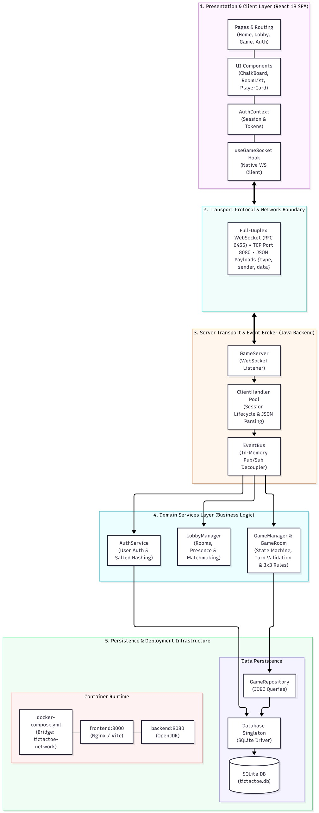
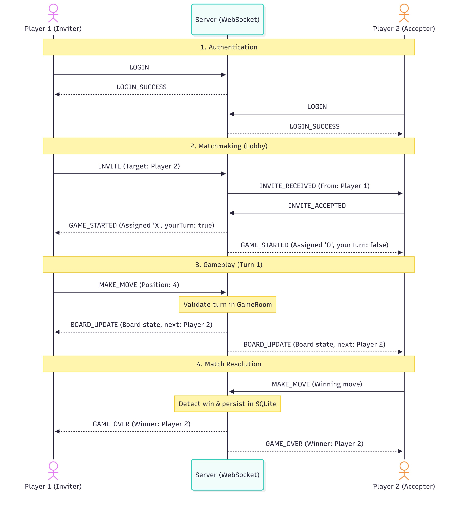

# TicTacToe Online

A real-time multiplayer Tic-Tac-Toe game built with Java WebSocket backend and React frontend. Play live against other players with instant synchronization, authentication, and game history tracking.

## Features

- **Real-time Multiplayer:** Play against other players with instant board synchronization via WebSocket
- **User Authentication:** Register and login system with secure password hashing (SHA-256)
- **Online Lobby:** See available players, send and receive game invitations
- **Single Player Mode:** Challenge an AI bot with strategic play
- **Rematch System:** Play multiple games against the same opponent with role reversal
- **Game History:** All games are persisted with winner tracking and board states
- **Responsive UI:** Tailwind CSS design that works on desktop and mobile
- **Containerized Deployment:** Full Docker Compose setup for easy deployment

## Tech Stack

### Backend
- **Language:** Java 8
- **Build Tool:** Maven 3.9
- **Real-time Communication:** Java-WebSocket 1.5.4
- **Serialization:** Gson 2.10.1
- **Database:** SQLite (sqlite-jdbc 3.43.0.0)
- **Testing:** JUnit 4.13.2

### Frontend
- **Framework:** React 19.2.8
- **Build Tool:** Vite 8.3.0
- **Routing:** React Router DOM 7.18.4
- **Styling:** Tailwind CSS 3.4.19
- **Icons:** Lucide React
- **Linting:** oxlint

### DevOps
- **Containerization:** Docker
- **Orchestration:** Docker Compose
- **Web Server:** Nginx (Alpine)
- **Node.js:** 20 Alpine (for frontend builds)

## Architecture Overview

The application follows a **client-server architecture** with WebSocket as the primary communication protocol.


### Key Components

**Backend:**
- **GameServer:** WebSocket server managing multiple concurrent connections
- **ClientHandler:** Per-connection handler routing messages and managing authentication
- **EventBus:** Async pub/sub with single-thread executor for thread-safe event processing
- **GameManager:** Manages active games, move validation, win detection
- **LobbyManager:** Tracks online players, routes invitations
- **GameRoom:** Encapsulates game state (board, turns, win conditions)
- **Database:** Singleton SQLite connection with schema management

**Frontend:**
- **GameWebSocket:** Singleton WebSocket service with event listener system
- **AuthContext:** Global authentication state management
- **Pages:** Home, Login, Register, GameMode, Lobby, SinglePlayerGame, MultiplayerGame
- **Components:** Board display, invitation notifications, game results overlay

### System Architecture Layers

The application is organized into 5 distinct layers:



1. **Presentation & Client Layer (React 18 SPA)** - React components, routing, and authentication context
2. **Transport Protocol & Network Boundary** - Full-duplex WebSocket communication with JSON payloads
3. **Server Transport & Event Broker** - WebSocket server, ClientHandler pool, and EventBus pub/sub
4. **Domain Services Layer (Business Logic)** - AuthService, LobbyManager, GameManager with game rules
5. **Persistence & Deployment Infrastructure** - SQLite database and Docker containerization

## Getting Started

### Prerequisites

- **Docker & Docker Compose** (recommended for quick start)
- OR **Java 8+**, **Maven**, **Node.js 20+** (for manual setup)

### Quick Start with Docker

1. Clone the repository:
```bash
git clone <repository-url>
cd capstone
```

2. Build and run with Docker Compose:
```bash
docker-compose up --build
```

3. Open your browser and navigate to:
```
http://localhost:3000
```

The frontend will be available on port 3000, and the backend WebSocket server on port 8080.

### Manual Setup

#### Backend Setup

1. Navigate to the backend directory:
```bash
cd tictactoe-server
```

2. Build with Maven:
```bash
mvn clean package
```

3. Run the server (default port 8080):
```bash
java -jar target/tictactoe-server-1.0-SNAPSHOT-jar-with-dependencies.jar
```

Or specify a custom port:
```bash
java -jar target/tictactoe-server-1.0-SNAPSHOT-jar-with-dependencies.jar 9090
```

#### Frontend Setup

1. Navigate to the frontend directory:
```bash
cd frontend
```

2. Install dependencies:
```bash
npm install
```

3. Create a `.env` file with the WebSocket URL:
```
VITE_WS_URL=ws://localhost:8080
```

4. Run the development server:
```bash
npm run dev
```

The frontend will be available at `http://localhost:5173`

## Usage

### Creating an Account

1. Click **Register** on the home page
2. Choose a username and password
3. Click **Register** to create your account

### Playing Multiplayer

1. **Login** with your credentials
2. Select **Multiplayer** mode
3. You'll see the **Lobby** with online players
4. Click **Invite** on another player to start a game
5. Wait for them to accept or receive an invitation to play
6. The game will start automatically with real-time board synchronization

### Playing Against AI

1. **Login** with your credentials
2. Select **Single Player** mode
3. Play against the AI bot (you are O, bot is X)
4. The AI uses strategic moves: win → block → center → corner → random

### Rematch System

After a game ends, you can request a rematch:
1. Click **Rematch**
2. Wait for your opponent to accept
3. A new game starts with reversed roles

## Game Rules

- **Board:** 3×3 grid (positions 0-8)
- **Players:** Two players with symbols X and O
- **Turn Order:** The player who sent the invitation plays X and goes first
- **Win Condition:** First to complete three symbols in a row, column, or diagonal
- **Draw:** All 9 cells filled without a winner
- **Forfeit:** A player loses if they disconnect or explicitly forfeit

## Project Structure

```
capstone/
├── README.md                          # This file
├── PROJECT_OVERVIEW.md                # Detailed architecture documentation
├── docker-compose.yml                 # Docker orchestration
├── .env.example                       # Environment variables template
├── tictactoe.db                       # SQLite database (generated at runtime)
├── data/                              # Docker volume for persistent data
│
├── tictactoe-server/                  # Backend (Java)
│   ├── pom.xml                        # Maven dependencies
│   ├── Dockerfile                     # Multi-stage Docker build
│   └── src/main/java/com/tictactoe/
│       ├── App.java                   # Entry point
│       ├── auth/                      # Authentication service
│       ├── database/                  # SQLite management
│       ├── events/                    # Event Bus
│       ├── game/                      # Game logic and management
│       ├── lobby/                     # Lobby management
│       ├── server/                    # WebSocket server
│       ├── shared/                    # Shared DTOs and enums
│       └── logging/                   # Structured logging
│
└── frontend/                          # Frontend (React)
    ├── package.json                   # NPM dependencies
    ├── Dockerfile                     # Multi-stage Docker build
    ├── nginx.conf                     # Nginx configuration for SPA
    ├── .env.example                   # Environment variables template
    └── src/
        ├── main.jsx                   # React entry point
        ├── App.jsx                    # Main app component
        ├── routes/                    # Route definitions
        ├── context/                   # React Context for auth
        ├── hooks/                     # Custom React hooks
        ├── services/                  # WebSocket service
        ├── pages/                     # Page components
        ├── components/                # Reusable UI components
        └── utils/                     # Utility functions
```

## Communication Protocol

### Message Format

All messages use JSON with this structure:

```json
{
  "type": "MAKE_MOVE",
  "sender": "playerName",
  "payload": "{\"position\": 4}",
  "timestamp": 1697500000000
}
```

### Message Types

**Authentication:**
- `REGISTER` → `REGISTER_SUCCESS` / `REGISTER_ERROR`
- `LOGIN` → `LOGIN_SUCCESS` / `LOGIN_ERROR`

**Lobby:**
- `LIST_ONLINE_USERS` → `ONLINE_USERS_UPDATE`

**Invitations:**
- `INVITE` → `INVITE_RECEIVED` (on opponent's client)
- `INVITE_ACCEPTED` / `INVITE_REJECTED`

**Gameplay:**
- `MAKE_MOVE` → `BOARD_UPDATE`
- `FORFEIT` → `GAME_OVER`

**Rematch:**
- `REMATCH_REQUEST` → `REMATCH_WAITING` / `REMATCH_DECLINED`

**System:**
- `ERROR` (error response)
- `DISCONNECT` (connection closing)

For detailed documentation, see [PROJECT_OVERVIEW.md](PROJECT_OVERVIEW.md).

### Game Flow Sequence Diagram

The following diagram shows the complete flow of a multiplayer game from login through match resolution:



The diagram illustrates:
- **Phase 1:** Both players authenticate and receive `LOGIN_SUCCESS`
- **Phase 2:** Player 1 invites Player 2, who accepts the invitation
- **Phase 3:** Turn-based gameplay with `MAKE_MOVE` and `BOARD_UPDATE` messages
- **Phase 4:** Game resolution with win detection and database persistence

## Game Logic

### Win Detection

The game checks for victory after each move using 8 hardcoded win combinations:

- **Rows:** [0,1,2], [3,4,5], [6,7,8]
- **Columns:** [0,3,6], [1,4,7], [2,5,8]
- **Diagonals:** [0,4,8], [2,4,6]

### Board Representation

```
 0 | 1 | 2
-----------
 3 | 4 | 5
-----------
 6 | 7 | 8
```

Values: `0` = empty, `1` = X, `2` = O

## Database Schema

### Users Table
```sql
CREATE TABLE users (
  id INTEGER PRIMARY KEY AUTOINCREMENT,
  username TEXT UNIQUE NOT NULL,
  password_hash TEXT NOT NULL,
  created_at TIMESTAMP DEFAULT CURRENT_TIMESTAMP
);
```

### Games Table
```sql
CREATE TABLE games (
  id TEXT PRIMARY KEY,
  player1 TEXT NOT NULL,
  player2 TEXT NOT NULL,
  winner TEXT,
  result TEXT CHECK(result IN ('PLAYER_X_WIN', 'PLAYER_O_WIN', 'DRAW', 'FORFEIT')),
  board TEXT NOT NULL,
  status TEXT CHECK(status IN ('ACTIVE', 'FINISHED')),
  started_at TIMESTAMP DEFAULT CURRENT_TIMESTAMP,
  finished_at TIMESTAMP
);
```

### Server Logs Table
```sql
CREATE TABLE server_logs (
  id INTEGER PRIMARY KEY AUTOINCREMENT,
  event_type TEXT NOT NULL,
  username TEXT,
  game_id TEXT,
  message TEXT,
  created_at TIMESTAMP DEFAULT CURRENT_TIMESTAMP
);
```

## Testing

### Backend Tests

Run backend tests with Maven:

```bash
cd tictactoe-server
mvn test
```

Test files located in `src/test/java/com/tictactoe/`:
- `AuthServiceTest` - Authentication and password hashing
- `GameRepositoryTest` - Database persistence
- `LobbyManagerTest` - Lobby and invitation logic
- `ClientHandlerTest` - Message routing

Tests use in-memory SQLite for isolation.

### Frontend Testing

Linting:
```bash
cd frontend
npm run lint
```

## Environment Variables

### Backend (`.env`)
```
JAVA_OPTS=-Xmx512m          # JVM heap size
PORT=8080                    # Server port
```

### Frontend (`.env`)
```
VITE_WS_URL=ws://localhost:8080    # WebSocket server URL
VITE_API_URL=http://localhost:8080 # API base URL (if needed)
```

## Docker Deployment

### Build Images

```bash
docker-compose build
```

### Run Services

```bash
docker-compose up
```

Services:
- **Backend:** http://localhost:8080 (WebSocket)
- **Frontend:** http://localhost:3000 (HTTP)
- **Database:** SQLite at `./data/tictactoe.db`

### Production Considerations

For production deployment:
1. Use a stronger hashing algorithm (bcrypt/Argon2) for passwords
2. Add HTTPS/WSS support
3. Implement JWT tokens for session management
4. Use a production database (PostgreSQL/MySQL)
5. Configure CORS properly
6. Add rate limiting and DDoS protection
7. Implement proper error handling and monitoring
8. Add request validation and sanitization

## Architecture Decisions

### Single-Thread Event Bus

All domain logic is processed on a single thread via `EventBus` using `Executors.newSingleThreadExecutor()`. This eliminates race conditions without needing locks or synchronized blocks, since:
- Multiple WebSocket connections run on different threads
- All events are queued and processed FIFO
- Handlers access shared state (GameRoom, LobbyManager) safely

### WebSocket-Only Protocol

No REST API — all communication uses WebSocket. Benefits:
- Single connection per client
- Bidirectional by default
- Simpler session management
- Natural for real-time updates

### SQLite Embedded Database

SQLite is sufficient for this project because:
- No external database server needed
- Portable (single file)
- Good for prototyping and MVPs
- Trade-off: limited for horizontal scaling


## License

This project is part of an academic capstone project for Rede de Computadores II.


## Acknowledgments

- Java-WebSocket library for WebSocket implementation
- React and Vite for frontend tooling
- Tailwind CSS for styling
- SQLite for embedded database

## Troubleshooting

### Port Already in Use

If port 8080 or 3000 is already in use:

**Backend:**
```bash
java -jar target/tictactoe-server-1.0-SNAPSHOT-jar-with-dependencies.jar 9090
```

Then update frontend `.env`:
```
VITE_WS_URL=ws://localhost:9090
```

**Frontend (with Vite):**
```bash
npm run dev -- --port 3001
```

### WebSocket Connection Failed

1. Verify backend is running: `http://localhost:8080`
2. Check `VITE_WS_URL` in frontend `.env`
3. Check browser console for errors
4. Verify firewall doesn't block the port

### Database Issues

1. Delete `tictactoe.db` to reset database
2. Ensure write permissions in project directory
3. Check disk space availability

